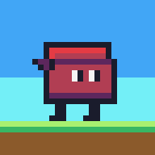
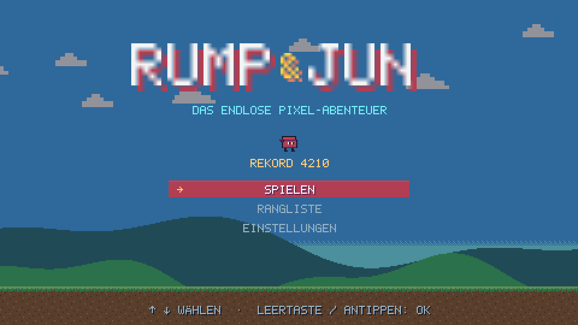
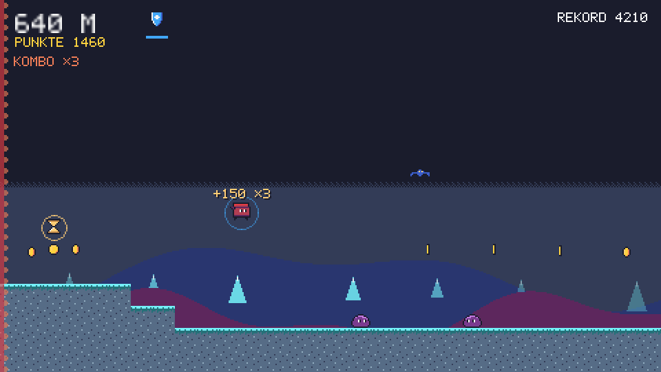
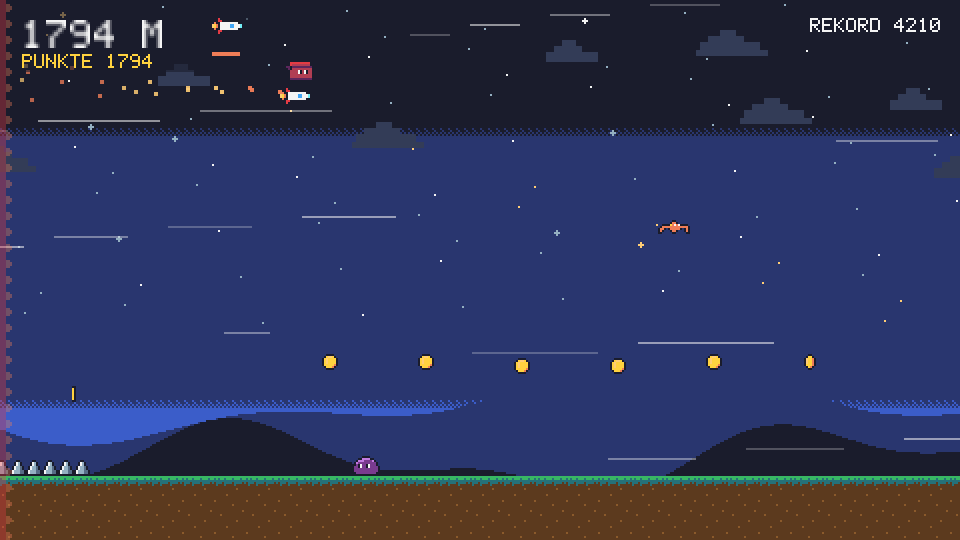
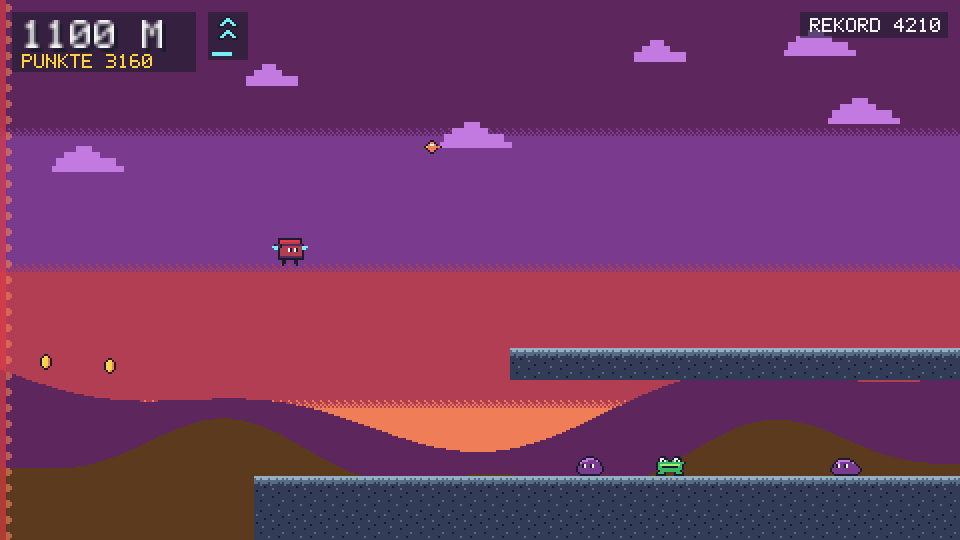

<div align="center">



# Rump & Jun

**A playful AI experiment disguised as an endless pixel-art platformer.**
The track scrolls on its own, gets faster and faster, and never ends. How far can you get?

[](LICENSE)


[](CONTRIBUTING.md)



</div>

---

## Contents

- [What is this?](#what-is-this)
- [About the game](#about-the-game)
- [Screenshots](#screenshots)
- [Quick start](#quick-start)
- [Controls](#controls)
- [Pixel Studio & skins](#pixel-studio--skins)
- [Building your own track sections](#building-your-own-track-sections)
- [Deploying](#deploying)
- [Under the hood](#under-the-hood)
- [Project structure](#project-structure)
- [Contributing](#contributing)
- [How it was made](#how-it-was-made)
- [Credits](#credits)
- [License](#license)

## What is this?

Rump & Jun is a small, humorous community game and an open experiment around AI-generated content, often called "AI slop". It asks two questions at once: **how far can a game get when it is built with AI, and how absurd can it become along the way?** Everyone is invited to push it further. Anything goes, as long as nobody is insulted and no one's rights are infringed.

The name is a wordplay on the video game genre "jump and run".

Good to know:

- It is an independent hobby project. It is not affiliated with or endorsed by any game publisher, by Anthropic, or by any other company.
- It is not intended as political commentary, and it is not intended to attack or impersonate any real person or organization.
- The game itself is a plain platformer. The satire lies in the project and how it was made, not in references to anyone.

## About the game

Rump & Jun is an endless, auto-scrolling pixel-art platformer. You run, jump and climb through a world that is generated as you play, while the left edge of the screen keeps pushing you forward.

- 🏃 **Endless track** built from 37 handcrafted sections across 5 difficulty tiers. The speed increases with every meter.
- 🧗 **Parkour:** wall jumps, wall slides and spring pads.
- 👾 **4 enemy types** (walkers, jumpers, flyers and diving hawks), plus moving and crumbling platforms.
- ⚡ **Power-ups:** double jump, shield, slow motion and the rare **rocket**, which carries you invincibly 500+ meters ahead.
- 🌄 **4 biomes** that change every 500 m (meadow, crystal cave, castle at sunset, starry night), each with its own music.
- 🏆 **Scoring** from distance, coins and enemy combos, plus a local arcade-style **top-10 leaderboard**.
- 🎚️ **Speed modes:** normal, fast and turbo, each with a score multiplier.
- 📱 **Desktop, phone and tablet:** touch controls, fullscreen, and it can be installed to your home screen as an app.
- 🎨 **Original assets:** the pixel art, pixel font, sound effects and chiptune music were made for this project. The color palette builds on *Sweetie 16* by GrafxKid (see [Credits](#credits)). No third-party assets are loaded at runtime.
- 🌍 **English and German:** switch under *Settings → Language*. On first launch the game follows your browser's language.

## Screenshots

<table>
  <tr>
    <td></td>
    <td></td>
  </tr>
  <tr>
    <td align="center"><sub>Crystal cave: combo and shield</sub></td>
    <td align="center"><sub>Rocket ride through the starry night</sub></td>
  </tr>
  <tr>
    <td></td>
    <td></td>
  </tr>
  <tr>
    <td align="center"><sub>Castle at sunset with double jump</sub></td>
    <td align="center"><sub>Title screen</sub></td>
  </tr>
</table>

## Quick start

All you need is [Node.js](https://nodejs.org) 18 or newer. Playing and developing require no extra packages.

```bash
git clone https://github.com/mpmamaci/rump-and-jun.git
cd rump-and-jun
npm run dev
```

| What | URL |
|---|---|
| Game | <http://localhost:8765> |
| Pixel Studio | <http://localhost:8765/tools/pixel-studio/> |

**Testing on a phone or tablet:** `npm run dev:lan` also makes the server reachable on your local Wi-Fi and prints the right addresses at startup. Only use this mode on your home network, since anyone on that Wi-Fi could save skins.

### All commands

| Command | Purpose |
|---|---|
| `npm run dev` | dev server with game and Pixel Studio (localhost only) |
| `npm run dev:lan` | same as `dev`, but reachable on your local network |
| `npm run check` | validates all track sections |
| `npm run build` | builds the minified version for static hosting into `dist/` |
| `npm run icons` | generates the app icons from the player sprite |

## Controls

| Keyboard | Action |
|---|---|
| <kbd>←</kbd> <kbd>→</kbd> / <kbd>A</kbd> <kbd>D</kbd> | run |
| <kbd>Space</kbd> / <kbd>W</kbd> / <kbd>↑</kbd> | jump (hold longer to jump higher); against a wall: wall jump |
| <kbd>Esc</kbd> / <kbd>P</kbd> | pause |
| <kbd>F</kbd> | fullscreen |
| <kbd>R</kbd> | restart |
| <kbd>M</kbd> | sound on/off |

**Phone & tablet:**
- On-screen buttons for running, jumping and pausing. They sit next to the game view so they never cover your character. You can switch them to an overlay in the settings for a larger picture.
- Real fullscreen works on Android, iPad and desktop.
- On **iPhone**, use *Share → Add to Home Screen* to run the game as an app without browser bars.

## Pixel Studio & skins

The Pixel Studio (`tools/pixel-studio/`) is a small homemade graphics tool. It also works on an iPad with Apple Pencil.

1. **Sketch:** draw freely, or load a photo of a paper drawing.
2. **Convert:** the sketch is downscaled to the sprite size and reduced to the game's 24-color palette, with an optional outline.
3. **Refine:** edit individual pixels and create frames and animations, with onion skinning and a live preview.
4. **Save** into a **skin**.

The default sprites in `assets/sprites/` are **protected**. A skin in `assets/skins/<name>/` only contains the sprites it changes. Pick a skin in the game under *Settings → Skin*. `DEFAULT` restores the defaults at any time, and the studio's "↺ Standard wiederherstellen" button resets a single sprite.

Sprites are stored as readable JSON, one pixel row per line with one palette character per pixel, so changes stay easy to follow in `git diff`.

## Building your own track sections

The world is stitched together endlessly from **chunks** defined in `src/data/chunks.js`. Each character is one 16 × 16 px block, and one block equals one meter.

```js
{
  name: 'wandsprung', difficulty: 2,
  map: [
    "",
    "             CCCC",
    "        #   #######",
    "        #   #######",
    "            #######",
    "########################",
    "########################",
  ],
},
```

| Char | Meaning | Char | Meaning |
|---|---|---|---|
| `#` | ground | `E` | walker |
| `=` | platform | `J` | jumper |
| `~` | crumbling platform | `B` | flyer |
| `^` | spikes | `D` | diving hawk |
| `*` | spring pad | `M` / `V` | moving platform (horizontal / vertical) |
| `C` | coin | `?` | power-up slot |
| `P` | player start | `!` | rocket slot (rare, tier 2+) |

**Rules:** maps are aligned to the bottom of the world, and the first and last columns need ground in the bottom two rows. `npm run check` validates this automatically.

## Deploying

```bash
npm install     # once: installs the build tool esbuild
npm run build
```

Then upload the **contents** of `dist/` to any static web host. No server-side code is needed.

The build
- bundles and minifies JavaScript, CSS and HTML,
- compacts all sprites, skins and the font,
- adds content hashes to file names so browsers never serve a stale cache after an update,
- leaves out the Pixel Studio, the dev server and the docs.

> Opening `index.html` directly from disk won't work, because browsers only load ES modules over `http(s)://`.

## Under the hood

- **Vanilla JavaScript (ES modules) and Canvas 2D.** No framework and no runtime dependencies.
- **Pixel-perfect rendering:** the game renders internally at 480 × 270 and is scaled by whole device pixels on desktop.
- **Fixed timestep** at 60 updates per second, so the physics behave the same on every device. That keeps high scores fair.
- **Seeded generator** (Mulberry32): chunks are picked with weights by difficulty, and the same seed always produces the same track.
- **Synthesized audio** via the Web Audio API: oscillators and noise for every effect, plus a lookahead chiptune sequencer whose tempo follows the game speed.
- **Sprites as data:** a 24-color palette with one character per color makes biome recoloring a simple palette remap.
- **Leaderboard interface:** `LocalStore` saves in the browser, and a `ServerStore` can be added later without touching the game.
- **Homemade tooling with no extra packages:** dev server, chunk validator and a PNG encoder for the app icons.

## Project structure

```
rump-and-jun/
├── index.html               entry page
├── manifest.webmanifest     web app manifest (home screen, fullscreen)
├── styles/main.css          page and touch layout
├── src/
│   ├── main.js              startup, scaling, game loop
│   ├── game.js              game state, menus, power-ups, rocket
│   ├── config.js            all tuning values
│   ├── i18n.js              all in-game texts (German / English)
│   ├── core/                seeded randomness
│   ├── world/               endless world, difficulty curve
│   ├── entities/            player, enemies, platforms, power-ups
│   ├── render/              renderer, sprite loader, pixel font
│   ├── audio/               synthesizer and music sequencer
│   ├── ui/                  menus, touch, fullscreen
│   ├── data/                chunks, palette, biomes, songs
│   └── storage/             best score, leaderboard, settings
├── assets/
│   ├── sprites/             default sprites (protected)
│   ├── skins/               custom skins from the Pixel Studio
│   ├── fonts/               5 × 7 pixel font
│   └── icons/               app icons
├── tools/
│   ├── dev-server.mjs       dev server with save API for the studio
│   ├── pixel-studio/        sketch → pixel art → animation → skin
│   ├── build.mjs            build for static hosting
│   ├── check-chunks.mjs     track section validator
│   └── make-icons.mjs       app icons from the player sprite
└── docs/
    ├── PLAN.md              original game plan and milestones (German)
    ├── screenshots/
    └── prototype/           the very first single-file prototype
```

## Contributing

**Let's shape this game together!** Pull requests are very welcome, big or small:

- 🗺️ **New track sections:** a chunk is just a few lines of text, which makes it the easiest way to contribute.
- 🎨 **Sprites and skins** made in the Pixel Studio.
- 👾 **New enemies, power-ups or biomes.**
- 🎵 **Music:** a song is four chords and a few numbers in `src/data/music.js`.
- 🐛 **Bug reports and ideas** via [issues](https://github.com/mpmamaci/rump-and-jun/issues).

See [CONTRIBUTING.md](CONTRIBUTING.md) for the details.

## How it was made

Rump & Jun is based on my own ideas, direction and written input. It was created with the assistance of **Claude** by Anthropic, used through Claude Code. Claude helped write the code, the pixel art, the pixel font, the music and sound data and the tooling, and play-testing feedback was folded in along the way. Some sprites, such as the `test1` skin, were drawn by hand in the project's own Pixel Studio.

The code and project assets were developed or generated specifically for this project, with the exception of the color palette noted under [Credits](#credits). Anthropic is not involved in, affiliated with, or endorsing this project.

The original plan with all milestones is in [`docs/PLAN.md`](docs/PLAN.md) (German), and the very first prototype is in [`docs/prototype/`](docs/prototype/).

## Credits

- **Color palette:** 16 of the game's 24 colors are the [*Sweetie 16* palette by GrafxKid](https://lospec.com/palette-list/sweetie-16). The other 8 colors were added for this project. The palette page does not state a license. The palette is credited here and is not claimed as part of this project's own work.
- **Build tool:** [esbuild](https://esbuild.github.io) (MIT License) is used only to build the deployable version. It is a development dependency and is not part of the game.
- **AI assistance:** Claude by Anthropic, as described [above](#how-it-was-made).

## License

The source code and the original project assets in this repository (sprites, skins, pixel font, music and sound data, icons, screenshots and documentation) are released under the [MIT License](LICENSE), © 2026 mpmamaci, unless stated otherwise.

Exceptions and notes:
- The *Sweetie 16* color values are credited to their creator (see [Credits](#credits)) and are not relicensed by this project.
- Development dependencies such as esbuild are covered by their own licenses.
- Names and trademarks of third parties mentioned here (for example Claude, Anthropic or device and platform names) are not covered by this license.
- Parts of this project were created with AI assistance. How such content is treated under copyright law can differ between countries.
